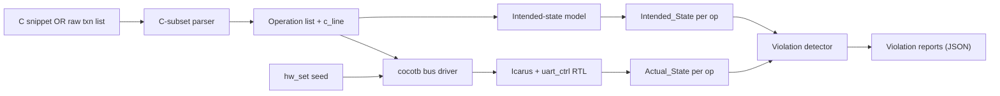

# Design Document

## Overview

RegSpectre's first co-verification core targets a UART peripheral. This feature delivers two artifacts: the SystemVerilog RTL `rtl/uart_ctrl.sv` (the source of truth for register behavior) and the deterministic Python `engine/` that drives that RTL through cocotb on Icarus Verilog, replays the register accesses a C firmware driver would perform, and reports every register bit that changed without the firmware intending it.

The engine catches two real firmware bugs driven by the bare-metal MMIO rules:

1. **W1C neighbor corruption** — a read-modify-write (`|=` / `&=`) on `UART_ISR` reads back all set interrupt bits, ORs/ANDs in a mask, and writes the value back; because `UART_ISR` bits are write-one-to-clear, every set bit in the written value is cleared, wiping pending neighbor interrupts the firmware meant to keep.
2. **Read-to-clear data loss** — reading `UART_RDR` a second time within one interrupt handler returns zeros because the first read cleared the register, silently losing received data.

Out of scope: the Next.js `web/` studio, DMA, watchdog, and any MCP server. The engine is deterministic Python with no LLM calls.

## Architecture

### SystemVerilog module: `rtl/uart_ctrl.sv`

`uart_ctrl` extends the existing `w1c_smoke.sv` pattern (read `status`, clear by `we`/`wdata`, set by `hw_set`) to two address-decoded registers with mixed bit types.

**Module interface**

```systemverilog
module uart_ctrl(
  input  wire        clk,
  input  wire        rst_n,
  // Bus_Interface
  input  wire        we,        // write enable
  input  wire        re,        // read enable
  input  wire [31:0] addr,      // full byte address
  input  wire [31:0] wdata,
  output reg  [31:0] rdata,
  // Hardware inputs
  input  wire [3:0]  hw_set,    // bit i sets interrupt bit i
  input  wire        rx_valid,
  input  wire [7:0]  rx_data
);

reg [3:0] isr;   // UART_ISR bits 3:0
reg [7:0] rdr;   // UART_RDR bits 7:0
```

**Register map**

| Register  | Address      | Bits       | Type                                          |
|-----------|--------------|------------|-----------------------------------------------|
| UART_ISR  | 0x40001004   | 0 TX_DONE   | W1C (write 1 clears, write 0 no-op)           |
|           |              | 1 RX_READY  | read-only; set by rx_valid, cleared by RDR read |
|           |              | 2 PARITY_ERR | W1C                                           |
|           |              | 3 OVERRUN_ERR| W1C                                           |
| UART_RDR  | 0x40001008   | 7:0        | read-to-clear; loaded by rx_valid             |

**Address decode**

```systemverilog
localparam [31:0] ISR_ADDR = 32'h40001004;
localparam [31:0] RDR_ADDR = 32'h40001008;
wire sel_isr = (addr == ISR_ADDR);
wire sel_rdr = (addr == RDR_ADDR);
```

**Combinational read data** (read returns current value; side effects land on the clock edge):

```systemverilog
always @(*) begin
  if (sel_isr)      rdata = {28'b0, isr};
  else if (sel_rdr) rdata = {24'b0, rdr};
  else              rdata = 32'b0;
end
```

**UART_ISR next-state logic**

```systemverilog
// W1C clear applies only to writable bits 0,2,3 (mask 4'b1101); bit 1 (RX_READY) excluded.
wire [3:0] clear_mask = (we & sel_isr) ? (wdata[3:0] & 4'b1101) : 4'b0000;

// RDR read clears RX_READY (bit 1): rdr_clear_mask has bit 1 = rdr_read.
wire rdr_read  = re & sel_rdr;
wire [3:0] rdr_clear_mask = {2'b00, rdr_read, 1'b0};

// Hardware set: bit 0 TX_DONE, bit 1 RX_READY (rx_valid), bit 2 PARITY_ERR, bit 3 OVERRUN_ERR.
// OVERRUN_ERR also set on overrun (rx_valid while RX_READY set and RDR not being read).
wire overrun   = rx_valid & isr[1] & ~rdr_read;   // see Design Decision (a)/(b)
wire [3:0] hwset_mask = { hw_set[3] | overrun, hw_set[2], rx_valid, hw_set[0] };

// hw_set wins over W1C clear and RDR-read clear: OR applied after both clears (Requirement 1.7).
wire [3:0] isr_next = (isr & ~clear_mask & ~rdr_clear_mask) | hwset_mask;
```

**UART_RDR next-state logic**

```systemverilog
// rx_valid loads new rx_data; RDR read clears to 0. Read + rx_valid in same cycle: rx_valid wins.
wire [7:0] rdr_next = rx_valid ? rx_data : (rdr_read ? 8'd0 : rdr);
```

**Clocked update + reset** (Requirement 1.5 zeroes both on `rst_n` low):

```systemverilog
always @(posedge clk or negedge rst_n) begin
  if (!rst_n) begin
    isr <= 4'd0;
    rdr <= 8'd0;
  end else begin
    isr <= isr_next;
    rdr <= rdr_next;
  end
end
```

**Behavioral consequences of the logic above:**
- Write 1 to a W1C bit clears it; write 0 leaves it unchanged (Requirements 1.2, 1.4) — `clear_mask` only carries 1s from `wdata` on writable bits.
- Writes to bit 1 are ignored (Requirement 1.8) — `clear_mask[1]==0`; RX_READY is driven only by `rx_valid` (set) and `rdr_read` (clear via `rdr_clear_mask`), with `hwset_mask` ORed last.
- `hw_set` priority over W1C clear and RDR-read clear (Requirement 1.7, Decision c) — `hwset_mask` is ORed after `clear_mask` and `rdr_clear_mask` are subtracted.
- `rx_valid` sets RX_READY and loads RDR (Requirement 1.6) — `hwset_mask[1]=rx_valid`, `rdr_next=rx_data` when `rx_valid`.
- Read of RDR returns old value then clears RDR and RX_READY at the edge (Requirement 2.1) — `rdata` is combinational (old `rdr`); `rdr_next` zeroes RDR when `rdr_read` and no `rx_valid`; `rdr_clear_mask` zeroes RX_READY via `isr_next`. If `rx_valid` coincides with the read, `hwset_mask[1]` re-sets RX_READY so it stays set for the new data.

### Design decisions resolved in the RTL

**(a) `rx_valid` and a UART_RDR read in the same cycle** — the read returns the *old* `rdr` value (combinational `rdata`), and the new `rx_data` is loaded at the edge (`rdr_next = rx_data` because `rx_valid` takes priority over `rdr_read` in the ternary). RDR does not clear to 0 because `rx_valid` wins. RX_READY stays set because `rdr_clear_mask` clears bit 1 but `hwset_mask[1] = rx_valid` re-sets it via the OR. Overrun is **not** flagged (`overrun = rx_valid & isr[1] & ~rdr_read = 1 & 1 & 0 = 0`) because the old data was successfully read, not lost.

**(b) `rx_valid` while RX_READY already set (and RDR not being read)** — the new `rx_data` overwrites the unread old data and `OVERRUN_ERR` (bit 3) is set (`overrun = rx_valid & isr[1] & ~rdr_read == 1`). This is the data-loss overrun condition.

**(c) `hw_set` priority over W1C clear** — confirmed: `isr_next = (isr & ~clear_mask & ~rdr_clear_mask) | hwset_mask`, so a simultaneous set and clear (or RDR-read clear) leaves the bit set.


## Components and Interfaces

The engine is a pipeline of pure-Python components. The only non-deterministic-looking part (the simulator) is driven deterministically from a seed, and no component invokes an LLM.



### 1. cocotb bus driver (`engine/bus_driver.py`)

A thin async wrapper over the cocotb DUT that issues one Bus_Interface transaction per call and returns the sampled `rdata` plus the clock-cycle stamp. Every transaction is one rising edge; signals are deasserted between transactions so consecutive operations are isolated.

| Method | Bus signals driven | Returns |
|--------|--------------------|---------|
| `write(addr, data)` | `we=1, re=0, addr, wdata=data` | `cycle` |
| `read(addr)` | `we=0, re=1, addr` | `(rdata, cycle)` |
| `rmw(addr, mask, mode)` | `read` then `write` of computed value | `(old, new, cycle)` |

`cycle` = count of `posedge clk` since the last reset, captured at the edge where the transaction commits. This is the value placed in every `Violation_Report`.

`rmw` modes:
- `SET`: `written = old | mask` (the `|=` case).
- `CLR`: `written = old & ~mask` (the `&= ~mask` case).

The driver is seeded for determinism (Requirement 8.1): the hw_set schedule applied between/around transactions is produced by `random.Random(seed)`, so identical `(rtl, c_snippet, seed)` drives identical sim inputs.

### 2. C-subset parser (`engine/c_parser.py`)

Parses a small, fixed C subset — **not** a C compiler (Requirement 3.5). A symbol table maps register names to addresses and declares each bit's type (W1C / read-only / read-to-clear). Each parsed statement becomes one `Operation` carrying its source line number for `c_line`.

Supported statements and their transaction mapping:

| C construct | Example | Operation | Transaction |
|-------------|---------|-----------|-------------|
| Direct assignment | `UART_ISR = (1U << TX_DONE);` | `WRITE` mask=`{0}` | `write(ISR, 1<<0)` |
| Compound OR | `UART_ISR \|= (1U << TX_DONE);` | `RMW` mode=`SET` mask=`{0}` | `rmw(ISR, {0}, SET)` |
| Compound AND | `UART_ISR &= ~(1U << PARITY_ERR);` | `RMW` mode=`CLR` mask=`{2}` | `rmw(ISR, {2}, CLR)` |
| Read into local | `uint32_t s = UART_ISR;` | `READ` | `read(ISR)` |
| Read RDR | `uint8_t d = UART_RDR;` | `READ` (read-to-clear) | `read(RDR)` |
| Handler | `void handler(void) { ... }` | scope marker | groups contained `READ`s for double-read detection |

Expressions are limited to `(1U << BIT)`, integer constants, `~`, `|`, `&`, and bit-name references from the symbol table. Loops, function calls, pointer arithmetic, and conditionals are **rejected** by the parser with a defined error (Requirement 3.5). The parser records the 1-based source line of each statement as `c_line`.

### 3. Intended-state model (`engine/intended_model.py`)

Pure function `intended_state(op, pre) -> Intended_State`. It mirrors what the firmware operation names and expects, applying W1C write semantics to the named mask only (bits the operation did not name are untouched).

For an operation naming bit mask `M` and writing value `written`:
- **Bits outside `M`**: `Intended_State[i] = pre[i]` (Requirement 4.4) — the firmware did not name them, so they should not change.
- **Bits inside `M`**: `Intended_State[i] = 0` if `written[i] == 1` (W1C write-1 clears), else `pre[i]` (write-0 leaves unchanged).

Per operation type (matches the existing `test_smoke.py` computation `intended = old & ~MASK`):
- **Direct assignment** `UART_ISR = (1U << BIT)`: `M={BIT}`, `written = (1<<BIT)`. Intended = `pre` with bit `BIT` cleared; all other bits = `pre`. (The mmio-rule-1 correct clear.)
- **RMW `|= MASK`** (SET): `M = MASK`, `written = pre | MASK`. Intended clears the `M` bits (W1C effect of writing 1) and keeps all bits outside `M` at `pre`. The *actual* RTL clears every set bit in `written` (the whole read-back value), so neighbors outside `M` that were set get cleared — the violation.
- **RMW `&= ~MASK`** (CLR): `M = MASK`, `written = pre & ~MASK`. Intended keeps `M` bits at `pre` (write-0 no-op) and bits outside `M` at `pre`.

### 4. Violation detector (`engine/detector.py`)

Pure function comparing `Intended_State` against `Actual_State` (read from the RTL by the bus driver). A violation is emitted only for the loss pattern **Intended=1, Actual=0** — a bit that should have stayed set but was cleared.

**W1C neighbor corruption (Requirement 5):** after an RMW on `UART_ISR`, for each bit `i` where `Intended_State[i]==1` and `Actual_State[i]==0`, emit a `Violation_Report` with `register=UART_ISR`, `bit=i`, `intended=1`, `actual=0`, `cycle` (the RMW's commit cycle), and `c_line` if the operation came from a C snippet. Bits outside `M` that were pending and got cleared are exactly these — the neighbor wipeout. Direct assignment clears only its target, so `Intended==Actual` and no report is emitted (Requirement 5.2).

**Read-to-clear double read (Requirement 6):** the detector scopes `READ` operations to the enclosing handler. Within one handler:
- The **first** `read(UART_RDR)` is the baseline; its returned value is the intended data (no report).
- The **second** `read(UART_RDR)` in the same handler: for each bit `i` that was 1 in the first read and 0 in the second read, emit a `Violation_Report` with `register=UART_RDR`, `bit=i`, `intended=1`, `actual=0`, `cycle` (the second read's cycle), and `c_line` if from a snippet.
- A single RDR read in a handler emits no report (Requirement 6.2).

### 5. Report writer (`engine/report.py`)

Serializes `Violation_Report` records to JSON. `c_line` is included when the operation originated from a parsed C snippet and omitted for raw transaction lists (Requirements 7.2, 7.3).

## Data Models

### Register map (`engine/regmap.py`)

```python
REGISTERS = {
    "UART_ISR": {"addr": 0x40001004, "width": 4, "bits": {
        0: ("TX_DONE",    "W1C"),
        1: ("RX_READY",   "RO"),    # read-only; set by rx_valid, cleared by RDR read
        2: ("PARITY_ERR", "W1C"),
        3: ("OVERRUN_ERR","W1C"),
    }},
    "UART_RDR": {"addr": 0x40001008, "width": 8, "bits": {
        i: (f"RDR[{i}]", "RTC") for i in range(8)   # read-to-clear
    }},
}
```

### Operation

```python
@dataclass
class Operation:
    kind: str          # "WRITE" | "RMW" | "READ"
    reg: str           # register name
    mask: int          # named bit mask M
    mode: str = ""     # "SET" | "CLR" (RMW only)
    c_line: int | None # 1-based source line, None for raw lists
    handler: str = ""  # enclosing handler name (for double-read scoping)
```

### Violation_Report (JSON schema)

Fields: `register` (string), `bit` (non-negative int), `intended` (0|1), `actual` (0|1), `cycle` (non-negative int), `c_line` (int, omitted for raw transaction lists).

From a C snippet:

```json
{
  "register": "UART_ISR",
  "bit": 3,
  "intended": 1,
  "actual": 0,
  "cycle": 42,
  "c_line": 17
}
```

From a raw transaction list (same violation, `c_line` omitted):

```json
{
  "register": "UART_RDR",
  "bit": 5,
  "intended": 1,
  "actual": 0,
  "cycle": 88
}
```

## Correctness Properties

*A property is a characteristic or behavior that should hold true across all valid executions of a system — essentially, a formal statement about what the system should do. Properties serve as the bridge between human-readable specifications and machine-verifiable correctness guarantees.*

### Property 1: C-subset parser round-trip

*For any* statement in the supported C subset, parsing it into an `Operation` and serializing that `Operation` back to C-subset source yields an equivalent statement (same register, mask, and mode).

**Validates: Requirements 3.4**

### Property 2: Intended-state model respects the named mask

*For any* operation naming bit mask `M` and any pre-operation register state, `Intended_State[i] == pre[i]` for every bit `i` outside `M`; and for every bit `i` inside `M` of type W1C, `Intended_State[i]` equals the W1C write effect of the written value (`0` if `written[i]==1`, else `pre[i]`). For every bit `i` inside `M` that is not W1C, `Intended_State[i] == pre[i]`, because a write has no effect on it (bit 1, RX_READY, is read only; Requirement 1.8).

**Validates: Requirements 4.1, 4.4, 3.3**

### Property 3: Violation detection flags exactly the lost bits (neighbor corruption)

*For any* read-modify-write on `UART_ISR` with pre-state `pre` and mask `M`, the detector emits one `Violation_Report` per bit `i` where `Intended_State[i]==1` and `Actual_State[i]==0` — i.e. every pending W1C bit outside `M` that the RMW cleared — and emits no other reports.

**Validates: Requirements 4.3, 5.1**

### Property 4: Direct assignment produces no violations

*For any* direct assignment `UART_ISR = (1U << BIT)` and any pre-state, the detector emits zero `Violation_Report`s, because `Intended_State == Actual_State` (only the target bit changes, as intended).

**Validates: Requirements 5.2**

### Property 5: c_line presence matches the operation source

*For any* emitted `Violation_Report`, the `c_line` field is present if and only if the originating operation came from a parsed C snippet; it is omitted if and only if the operation came from a raw transaction list.

**Validates: Requirements 5.3, 7.2, 7.3**

### Property 6: Read-to-clear double-read detection

*For any* interrupt handler, if `UART_RDR` is read twice, the detector emits one `Violation_Report` per bit that was 1 in the first read and 0 in the second (`register=UART_RDR`, `intended=1`, `actual=0`); if `UART_RDR` is read once, the detector emits no double-read `Violation_Report`.

**Validates: Requirements 6.1, 6.2**

### Property 7: Violation report JSON validity and round-trip

*For any* `Violation_Report`, serializing to JSON yields an object whose `bit`, `intended`, `actual`, and `cycle` fields have the required types (non-negative int; 0|1; 0|1; non-negative int), and parsing that JSON back yields an equivalent report.

**Validates: Requirements 7.1**

### Property 8: Direct-assignment neighbor-safety under random hardware timing

*For any* Hypothesis-generated `hw_set` schedule, target bit `BIT`, and write cycle, a direct assignment `UART_ISR = (1U << BIT)` issued against the `uart_ctrl` RTL clears no W1C bit of `UART_ISR` other than `BIT` (no neighbor bit transitions set→cleared). If any neighbor W1C bit is wiped out, the test fails with a neighbor-wipeout indication.

**Validates: Requirements 9.1, 9.3**

## Error Handling

- **Parser rejects unsupported C** (Requirement 3.5): loops, function calls, pointer arithmetic, and conditionals raise a `ParseError` with the offending line number; the engine stops replaying that snippet and reports which statement was unsupported, without classifying any bits.
- **Unknown register or bit name**: the parser raises a `SymbolError`; the symbol table is the single source of register/bit metadata.
- **Bus decode miss** (`addr` matches neither `ISR_ADDR` nor `RDR_ADDR`): the RTL returns `rdata=0` and changes no register; the engine records an out-of-range-access warning rather than a violation (an access error is not an unintended bit change).
- **Simulator/compile failure**: the runner surfaces Icarus/cocotb stderr and exits non-zero; no partial violation reports are written.
- **Determinism on error**: because the engine is seeded and uses only deterministic Python, repeating a run that errored reproduces the same error at the same cycle.

## Testing Strategy

**Dual approach**: unit tests for concrete examples, edges, and integration; Hypothesis property tests for universal engine logic; cocotb sim tests for RTL behavior.

### Unit / example tests (pytest)

- RTL behavior (Requirements 1.1–1.8, 2.1): cocotb examples — W1C clear, write-0 no-op, `hw_set` set, reset-zero, `rx_valid` load + RX_READY, same-cycle `hw_set`/W1C priority, RX_READY write-ignored, RDR read-to-clear, address decode.
- Replay ordering (Requirement 3.2): parse a small snippet, assert transaction order.
- Unsupported C constructs (Requirement 3.5): feed loops/calls/pointers, assert `ParseError`.
- End-to-end determinism (Requirement 8.1): run the engine twice on the same seeded input, assert byte-identical reports.
- No-LLM structural check (Requirement 8.2): assert `engine/` imports no LLM client and makes no network calls.

### Property-based tests (Hypothesis, `@settings(derandomize=True, max_examples=100, deadline=None)`)

Each property test implements one design correctness property as a single `@given` test, minimum 100 examples, tagged:

```
# Feature: uart_core, Property 1: C-subset parser round-trip
```

| Test | Property | Strategy (what varies) | Oracle |
|------|----------|------------------------|--------|
| `test_parser_round_trip` | 1 | generated C-subset statements | serialize(parse(s)) ≡ s |
| `test_intended_respects_mask` | 2 | op, mask `M`, `pre` state | bits outside M == pre; bits in M = W1C write effect |
| `test_rmw_neighbor_corruption` | 3 | `pre`, RMW mask, mode | reports == {i : intended=1 & actual=0} |
| `test_direct_assignment_clean` | 4 | `pre`, target bit | zero reports |
| `test_c_line_presence` | 5 | op from snippet vs raw list | `c_line` present iff snippet |
| `test_double_read_detection` | 6 | first/second RDR read values | reports == bits 1→0; single read → none |
| `test_report_json_round_trip` | 7 | generated reports | valid typed JSON; parse(serialize(r)) ≡ r |

### Integration property test against RTL (Requirement 9)

`test_direct_assignment_neighbor_safety` (Property 8): Hypothesis generates a random `hw_set` schedule (per cycle, each of the 4 interrupt bits independently asserted/deasserted on random cycles), a target bit `BIT`, and a write cycle. The test compiles `rtl/uart_ctrl.sv` once, then for each example resets the DUT, applies the `hw_set` schedule, issues `UART_ISR = (1U << BIT)` via the bus driver, and asserts no W1C bit other than `BIT` transitions from set to cleared. `max_examples >= 100` (Requirement 9.2). Determinism via `derandomize=True`; CI may additionally pin `--hypothesis-seed=<const>`. Per Requirement 9.4, the test docstring and any output describe results as **randomized testing, not proof of correctness**.

### Test layout

- `tests/test_uart_ctrl.py` — cocotb RTL behavior examples (Requirements 1, 2).
- `tests/test_engine_unit.py` — pytest unit/example tests for parser, intended model, detector, report writer.
- `tests/test_engine_props.py` — Hypothesis property tests (Properties 1–7).
- `tests/test_pbt_hw_timing.py` — the Requirement 9 integration property test (Property 8), driving `uart_ctrl` via cocotb.
- `tests/Makefile` — extended with a `uart_ctrl` target (`VERILOG_SOURCES` adds `../rtl/uart_ctrl.sv`, `COCOTB_TEST_MODULES` adds the new test modules).